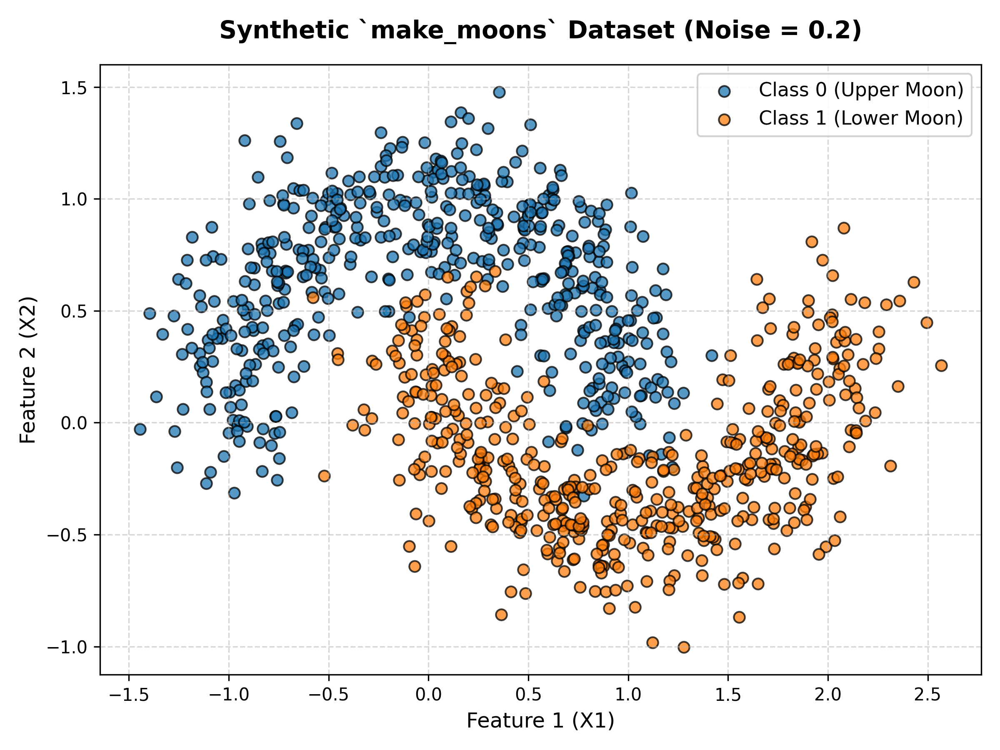
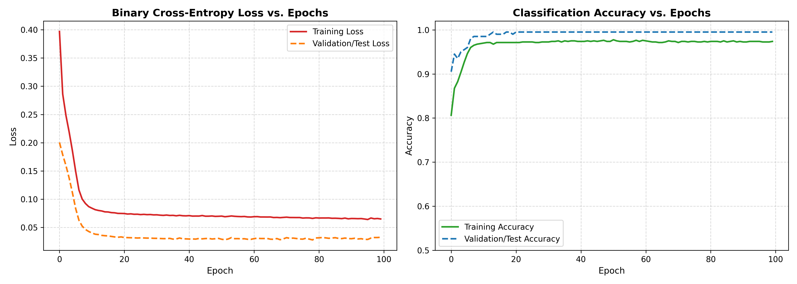
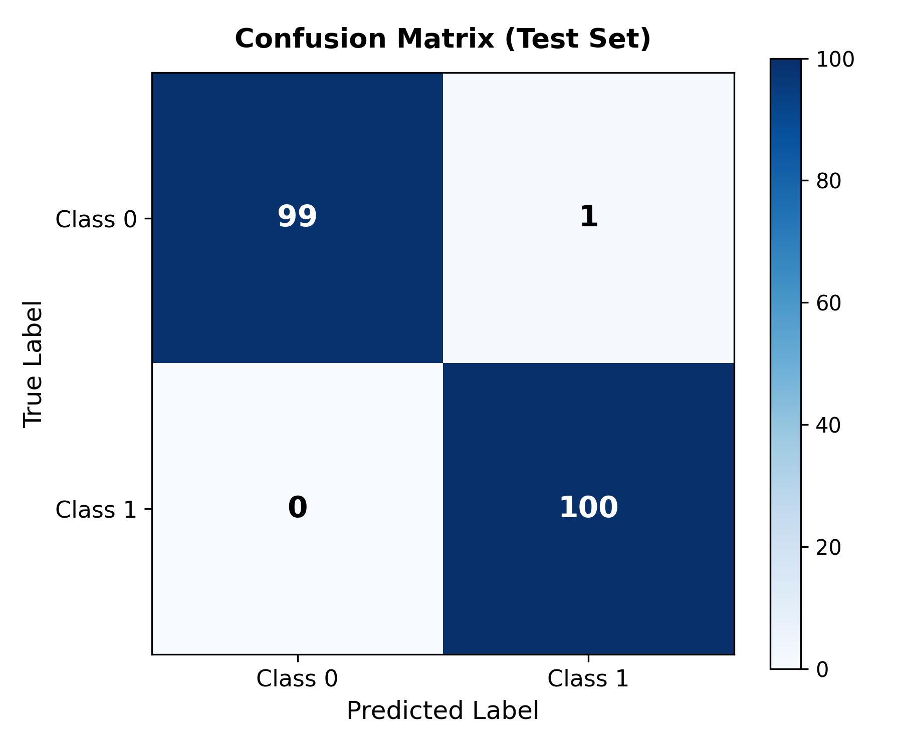
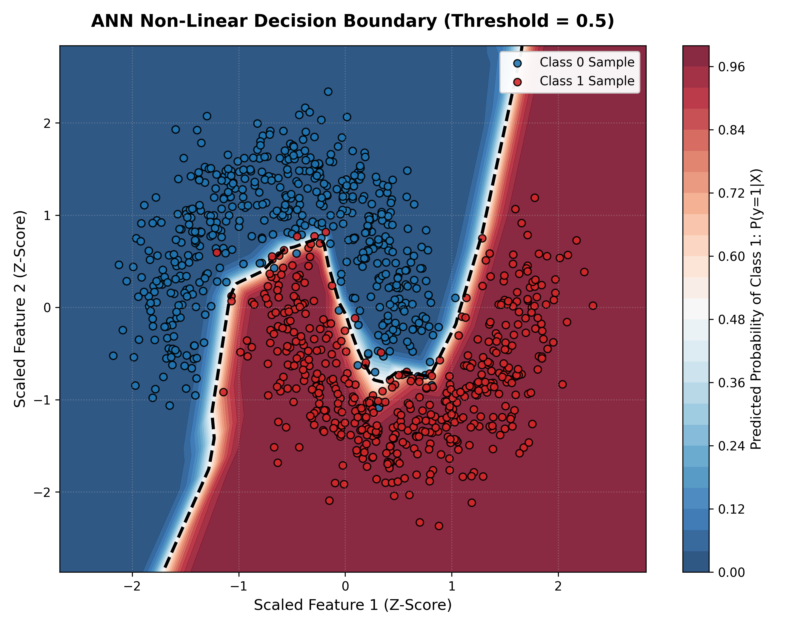

# Development of an Artificial Neural Network (ANN) for Binary Classification Using the `make_moons` Dataset

[](https://www.python.org/)
[](https://www.tensorflow.org/)
[](https://scikit-learn.org/)
[](LICENSE)

---

## 📌 Project Overview
This repository contains a complete, beginner-friendly, and production-grade implementation of an **Artificial Neural Network (ANN)** designed to solve a non-linear binary classification problem using the synthetic **`make_moons`** dataset from **Scikit-learn**.

While single-layer perceptrons or simple logistic regression models fail when decision surfaces are non-linear, a Multi-Layer Perceptron (MLP) equipped with non-linear activation functions (ReLU & Sigmoid) successfully projects input features into a latent representation where the two interlocking crescent moons become cleanly separable.

---

## 🎯 Project Objectives
1. **Dataset Synthesis:** Generate 1,000 samples of interlocking non-linear crescent moons using `make_moons` with Gaussian noise ($\sigma = 0.2$).
2. **Data Preprocessing:** Implement stratified 80:20 train-test splitting and Z-score feature standardization (`StandardScaler`).
3. **ANN Architecture:** Construct a sequential neural network in TensorFlow/Keras with 2 input features, two hidden layers (16 and 8 units with ReLU activations), and a single sigmoid output neuron.
4. **Model Training:** Train for 100 epochs with Adam optimizer ($\eta = 0.01$) and Binary Cross-Entropy loss, tracking training and validation trajectories.
5. **Model Evaluation:** Measure real test metrics (Accuracy, Precision, Recall, F1-Score, and Confusion Matrix).
6. **Decision Boundary Visualization:** Generate a 2D probability contour map overlaid with empirical data points to visualize non-linear decision surface geometry.
7. **Empirical Analysis:** Provide comprehensive scientific conclusions suitable for a university machine learning mini-project.

---

## 📂 Repository Structure
```text
ANN PROJECT/
│
├── main.py                             # Complete, executable Python script (all 7 steps)
├── ANN_Make_Moons_Classification.ipynb # Jupyter/Colab notebook with markdown & cells
├── requirements.txt                    # Project dependencies specification
├── build_notebook.py                   # Automation script for notebook generation
├── README.md                           # Quickstart guide and summary
├── PROJECT_REPORT.md                   # Full academic report for college submission
│
├── dataset_visualization.png           # Scatter plot of Class 0 vs Class 1
├── training_history.png                # Loss and Accuracy curves vs. Epochs
├── confusion_matrix.png                # Heatmap of test predictions vs ground truth
└── decision_boundary.png               # Learned probability manifold & threshold
```

---

## 🚀 Quickstart & Execution

### 1. Clone or Open the Workspace
```bash
cd "c:/Users/hp/ANN PROJECT"
```

### 2. Install Dependencies
```bash
pip install -r requirements.txt
```

### 3. Run the Standalone Script
```bash
python main.py
```
*This command executes the entire pipeline, prints console diagnostics, and saves all four visualization figures to the project root.*

### 4. Open in Jupyter Notebook or Google Colab
Launch the interactive notebook:
```bash
jupyter notebook ANN_Make_Moons_Classification.ipynb
```
Or upload `ANN_Make_Moons_Classification.ipynb` directly into [Google Colab](https://colab.research.google.com/).

---

## 📊 Empirical Results Summary

Trained with a fixed seed (`random_state=42`), the ANN achieved the following test metrics on 200 unseen samples:

| Metric | Measured Value | Description / Interpretation |
| :--- | :---: | :--- |
| **Test Accuracy** | **99.50%** | 199 out of 200 test samples correctly classified |
| **Test Loss** | **0.0325** | Low binary cross-entropy loss, indicating high confidence |
| **Precision** | **0.9901** | Ratio of true positive moon instances over predicted positives |
| **Recall** | **1.0000** | 100% of actual Class 1 samples identified without false negatives |
| **F1-Score** | **0.9950** | Harmonic mean of precision and recall |

### Detailed Classification Report
```text
                  precision    recall  f1-score   support

Class 0 (Moon A)       1.00      0.99      0.99       100
Class 1 (Moon B)       0.99      1.00      1.00       100

        accuracy                           0.99       200
       macro avg       1.00      0.99      0.99       200
    weighted avg       1.00      0.99      0.99       200
```

---

## 🖼️ Visualizations & Analysis

### 1. Dataset Generation (`dataset_visualization.png`)
The `make_moons` synthetic dataset with noise $\sigma = 0.2$ creates two interleaving crescents that cannot be partitioned by a single linear hyperplane.


### 2. Training Trajectory (`training_history.png`)
Both training and validation loss decay rapidly within the first 20 epochs and stabilize by epoch 50. Validation accuracy climbs from ~90% to 99.50% without divergence or severe overfitting.


### 3. Confusion Matrix (`confusion_matrix.png`)
On 200 unseen test instances (100 Class 0, 100 Class 1), the model achieved 99 True Negatives, 100 True Positives, 1 False Positive, and 0 False Negatives.


### 4. Learned Decision Boundary (`decision_boundary.png`)
The decision threshold line ($P = 0.5$, dashed black curve) snakes between the two crescent clusters, validating the model's non-linear separation capability.


---

## 🔬 Architectural Parameter Breakdown

```text
Model: "Moons_Binary_Classifier_ANN"
_________________________________________________________________
 Layer (type)                Output Shape              Param #   
=================================================================
 Input_Layer (InputLayer)    (None, 2)                 0         
 Hidden_Layer_1 (Dense)      (None, 16)                48        
 Hidden_Layer_2 (Dense)      (None, 8)                 136       
 Output_Layer (Dense)        (None, 1)                 9         
=================================================================
Total params: 193 (772.00 B)
Trainable params: 193 (772.00 B)
Non-trainable params: 0 (0.00 B)
_________________________________________________________________
```

- **Hidden Layer 1:** $(2 \text{ inputs} \times 16 \text{ neurons}) + 16 \text{ biases} = 48$ weights.
- **Hidden Layer 2:** $(16 \text{ inputs} \times 8 \text{ neurons}) + 8 \text{ biases} = 136$ weights.
- **Output Layer:** $(8 \text{ inputs} \times 1 \text{ neuron}) + 1 \text{ bias} = 9$ weights.
- **Total Trainable Parameters:** 193 parameters.
